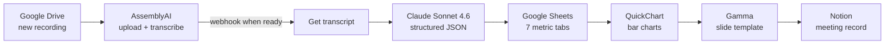

# Meeting & Reporting Automation

An event-driven Make.com pipeline that prepares a McDonald's franchise organization's Monday leadership meeting. From a meeting recording and a weekly metrics spreadsheet, it produces:

- a **structured AI summary** organized around the organization's six operating themes
- a **Gamma presentation** with store-by-store performance charts in leadership's preferred slide order
- a **Notion record** linking the deck, transcript and action items

It replaced a 3–4 hour manual process with a run of about 3 minutes and was approved by senior leadership for weekly use.

---

## Architecture



### Part 1: `01-drive-to-assemblyai.blueprint.json` (4 modules)

| Step | Module | What it does |
|---|---|---|
| 1 | Google Drive: Watch Files | Triggers when a recording lands in the meetings folder |
| 2 | Google Drive: Get a File | Downloads the recording |
| 3 | HTTP: POST `/v2/upload` | Uploads the audio to AssemblyAI |
| 4 | AssemblyAI: POST `/v2/transcript` | Starts transcription with speaker labels and registers Part 2's webhook |

### Part 2: `02-assemblyai-to-notion.blueprint.json` (45 modules)

| Stage | Modules | What it does |
|---|---|---|
| Trigger | AssemblyAI: Transcript Ready → Get Transcript | Starts when AssemblyAI calls the webhook |
| Summarize | HTTP → AssemblyAI LLM Gateway (`claude-sonnet-4-6`) | Returns a fixed JSON schema: executive summary, wins and playbook for six themes, efficiency score (1–10), detailed report with an action-item table |
| Parse | JSON: Parse JSON | Maps the model's output to typed fields |
| Chart engine | Drive: Search → 7 × (Sheets: Get Range → Aggregator → Set Variables → QuickChart) | Finds the latest metrics file and renders 16 charts across seven tabs |
| Deck | Gamma: Create from Template | Places every chart and theme summary on its slide |
| Log | Notion: Create Item → Append Content | Saves the summary, scores and links, then appends the full report |

**Six themes:** Safety First, People Power, Let's Talk Tech, Run the Play, Moments that Matter, The Bottom Line.

**16 charts per run:**

| Group | Charts |
|---|---|
| Breakfast, Lunch, Dinner | OEPE, R2P, drive-thru parked %, KVS healthy usage (4 each, 12 total) |
| Labor | Crew labor % |
| Food | Food over base % |
| Digital | Digital app % of total guest counts |
| Voice | Voice overall % |

Each chart compares six stores with the region and organization averages.

---

## Design decisions

**Webhook handoff between two scenarios.** Transcription takes minutes. Part 1 hands AssemblyAI a webhook URL and ends; Part 2 starts only when the transcript is ready. No polling, no timeouts.

**One scenario for summary and charts.** Gamma needs every chart URL the moment it runs, and Make can't reference modules in another scenario. So the chart engine was merged into the meeting workflow, placed after the summary is parsed and before Gamma. A failed transcription never spends operations on charts.

**The prompt is a contract.** The model must return one exact JSON structure, and any theme that wasn't discussed becomes `"Not discussed"` instead of being filled in. Downstream modules map fields directly, with no room for invented content. The parser also strips stray code fences in case the model adds them:

```
{{replace(replace(12.data.choices[].message.content; "```json"; emptystring); "```"; emptystring)}}
```

**Shaping spreadsheet rows for Chart.js.** Each metric column becomes a comma-separated list with `%` signs removed:

```
{{replace(join(map(33.array; "3"); ","); "%"; emptystring)}}
```

**Charts as images in a fixed template.** QuickChart renders each chart to a hosted PNG, and Gamma places it with markdown image syntax (``). Slide order follows the PowerPoint deck leadership already used, so the new report looks familiar.

---

## What broke, and how I fixed it

- **`map()` and formula syntax.** Charts failed until I learned that `map()` takes the array and the column key as separate arguments, that column keys are numeric strings (`"1"`–`"4"`), and that an empty replacement needs the `emptystring` keyword.
- **Aggregators can't share a source.** Two aggregators pointed at one Google Sheets module broke silently. Each tab now has its own Sheets module and aggregator.
- **Corrupted module IDs after copy-paste.** The Labor chart's aggregator kept reporting "invalid source module" even after it was rebuilt. The real cause was the upstream Sheets module's internal ID; deleting and recreating that module fixed it. A related lesson: Make's variable picker only lists modules that produced output in the last run, so a missing token means the whole upstream branch failed, not just a typo.
- **Proving the riskiest piece first.** Before merging 43 chart modules into the meeting workflow, I confirmed with a single hard-coded chart that Gamma would render a QuickChart URL. Then I exported a blueprint backup, merged, and built the deck four charts at a time.
- **Checking numbers, not checkmarks.** Every chart was verified against the source sheet, because a broken reference can render a perfect chart with the wrong tab's data.

---

## Results

- **3–4 hours → ~3 minutes** per weekly report (~98% less time)
- **~180 hours saved per year** (estimated)
- End-to-end testing first produced a complete **12-chart PDF report** (breakfast, lunch and dinner) from real store-level data. The Labor, Food, Digital and Voice charts were then added, bringing each weekly deck to **16 charts**.
- Approved by senior leadership for the weekly meeting

---

## Tools

Make.com · Google Drive · AssemblyAI (speech-to-text + LLM Gateway) · Claude Sonnet 4.6 · Google Sheets · QuickChart API · Gamma · Notion

---

## Running it yourself

1. In Make, open the scenario editor, click **⋯**, choose **Import Blueprint**, and import Part 1, then Part 2.
2. Reconnect your own Google, AssemblyAI, Gamma and Notion accounts.
3. Replace every `YOUR_…` placeholder (API keys, folder and database IDs, template ID).
4. Paste Part 2's webhook URL into the `webhook_url` field of Part 1's transcript request.

All keys, IDs and business data have been removed from these files.

---

## Next steps

- **Error handlers on chart modules**, so one bad spreadsheet cell drops a single chart instead of stopping the whole run (and the meeting summary with it).
- **Fewer modules.** The chart steps repeat one pattern seven times. An iterator feeding a single chart module would shrink Part 2 considerably.
- **Durable chart links.** Check QuickChart's retention policy so older decks never show broken images.
